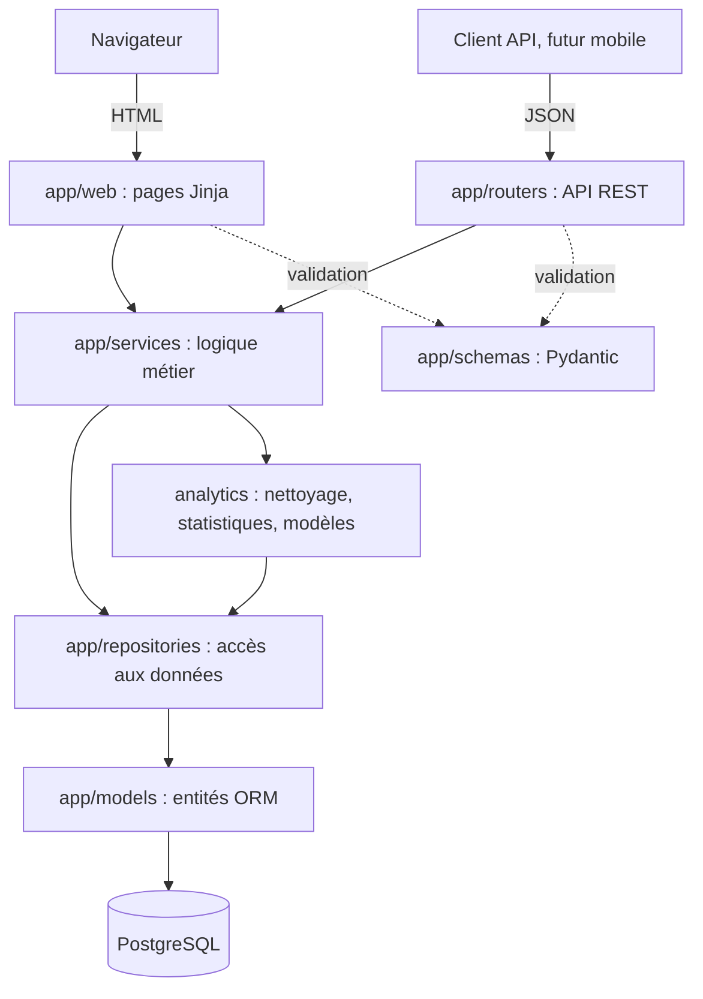
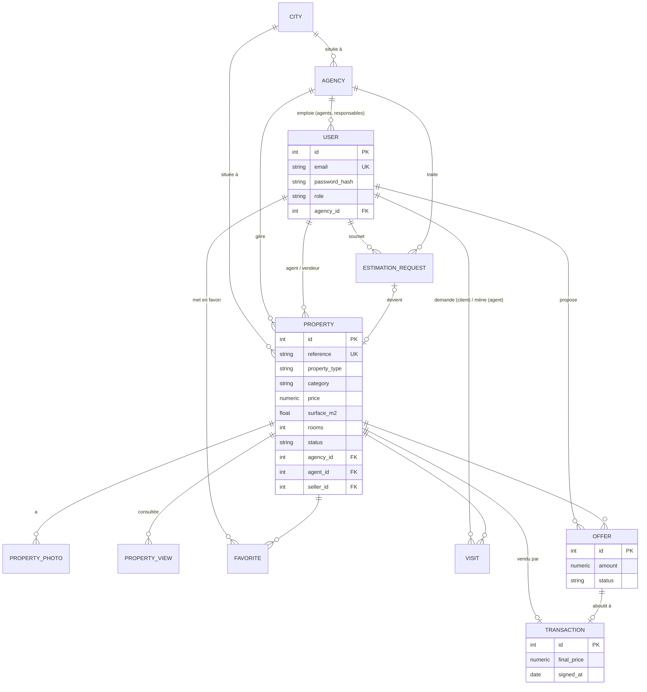
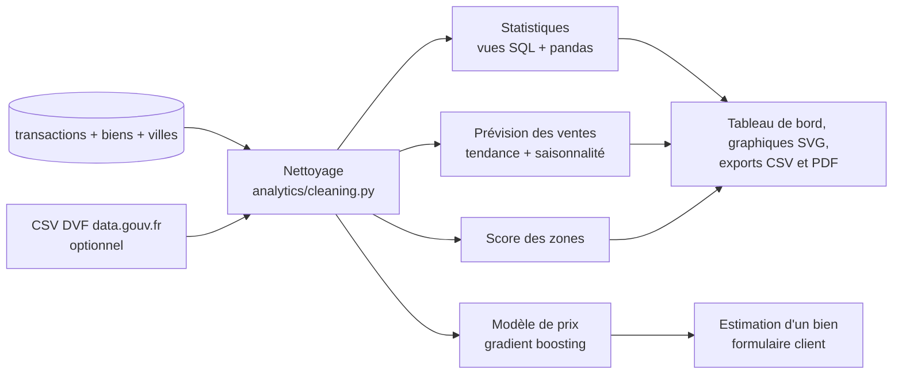

# Documentation technique — Plateforme Ymmo

Livrable DEV · Documentation technique. Elle décrit **comment** la plateforme est construite.
Les fonctionnalités et les règles métier sont dans les
[spécifications fonctionnelles](specifications-fonctionnelles.md).

## 1. Pile technique

| Couche | Technologie | Pourquoi |
|---|---|---|
| Langage | Python 3.12 | Un seul langage pour le web et l'analyse de données (pandas, scikit-learn) |
| Framework web | FastAPI 0.115 + Uvicorn | API REST typée, validation automatique (Pydantic), documentation OpenAPI générée (`/docs`), injection de dépendances |
| Pages web | Jinja2, CSS et JavaScript sans framework | Rendu côté serveur : pages rapides, référencement, fonctionne sans JavaScript ; le JavaScript n'ajoute que des améliorations (animations, prévisualisations) |
| Base de données | PostgreSQL 16 | Relationnel (les données sont fortement liées), contraintes et vues SQL, index partiels |
| ORM et migrations | SQLAlchemy 2.0 (typé) + Alembic | Modèles orientés objet, migrations versionnées et rejouables |
| Sécurité | argon2-cffi, PyJWT | Hachage Argon2id (recommandé par l'OWASP), jetons signés |
| Données / IA | pandas, NumPy, scikit-learn, matplotlib | Nettoyage, statistiques, régression, graphiques SVG |
| Images | Pillow | Contrôle du format et ré-encodage des photos envoyées |
| Conteneurs | Docker, Docker Compose | Même environnement en développement, en CI et en production |
| Qualité | pytest, ruff, black, GitHub Actions | Tests automatisés, lint et formatage vérifiés à chaque push |

## 2. Architecture

### 2.1 Couches

L'application suit une **architecture en couches orientée services**. Chaque couche ne
connaît que celle du dessous, et la logique métier est écrite une seule fois, partagée par
l'API et par les pages web.



| Dossier | Rôle | Exemple |
|---|---|---|
| `app/routers/` | API REST : routes, codes HTTP, dépendances (utilisateur courant, rôle) | `properties.py` : `GET /api/properties` |
| `app/web/` | Pages HTML : mêmes services, réponses en HTML et redirections | `public.py` : accueil, recherche, fiche |
| `app/schemas/` | Contrats d'entrée et de sortie (Pydantic) : types, bornes, cohérence | `PropertyFilters` refuse un prix minimum supérieur au prix maximum |
| `app/services/` | Règles métier, orchestration, transactions | `ClientService.request_visit` vérifie le créneau |
| `app/repositories/` | Requêtes SQL (SQLAlchemy) regroupées par agrégat | `PropertyRepository.search` |
| `app/models/` | Entités, relations, contraintes, automates de statut | `Property`, `Offer`, `Visit` |
| `app/core/` | Transversal : configuration, base, sécurité, erreurs, middlewares | `security.py`, `middleware.py` |
| `analytics/` | Traitement des données et IA, indépendant du web | `cleaning.py`, `predictive.py` |
| `scripts/` | Démarrage du conteneur, jeu de données de démonstration | `seed.py`, `entrypoint.sh` |
| `alembic/` | Migrations du schéma et des vues SQL | |
| `tests/` | Tests automatisés | |

### 2.2 Gestion des erreurs

Les services lèvent des **erreurs métier** typées. Un gestionnaire unique les traduit en
réponse HTTP : JSON pour l'API, page d'erreur ou redirection pour le web. Aucun service ne
connaît HTTP.

| Exception | Code HTTP | Exemple |
|---|---|---|
| `NotFoundError` | 404 | Bien inexistant |
| `AuthenticationError` | 401 | Identifiants incorrects (sur le web : redirection vers `/connexion`) |
| `PermissionDeniedError` | 403 | Un agent modifie le bien d'un collègue |
| `ConflictError` | 409 | Seconde offre en attente sur le même bien |
| `BusinessRuleError` | 422 | Visite demandée un dimanche |
| `TooManyAttemptsError` | 429 | Plus de 5 échecs de connexion en 15 minutes |

## 3. Programmation orientée objet et patrons de conception

| Principe ou patron | Où | Intérêt |
|---|---|---|
| **Héritage et polymorphisme** | `User` → `Client`, `Agent` → `AgencyManager`, `Admin` (héritage SQLAlchemy sur une table, discriminant `role`) | `user.can_manage_property(bien)` est redéfinie par chaque rôle : l'agent gère ses biens, le responsable ceux de son agence, la Direction tous. Aucun `if role == …` dispersé dans le code |
| **Automate à états** (mixin) | `StateMachineMixin`, utilisé par `Property`, `Visit`, `Offer`, `EstimationRequest` | Chaque entité déclare sa table de transitions ; un changement interdit lève une erreur, quel que soit l'appelant. Un nouvel objet n'a qu'à déclarer sa table (principe ouvert/fermé) |
| **Stratégie** + inversion de dépendance | `PriceEstimator` (protocole), avec deux implémentations : `MLPriceEstimator` et `MarketAverageEstimator` | Le service d'estimation ne dépend que de l'interface. Le modèle d'IA est utilisé s'il existe, sinon la moyenne du marché prend le relais |
| **Repository** | `app/repositories/` | Les requêtes sont isolées et testables ; les services ne manipulent pas de SQL |
| **Injection de dépendances** | `Depends()` de FastAPI : session de base, utilisateur courant, rôle exigé (`require_staff`, `require_admin`) | Les tests remplacent facilement la base ou le stockage des images |
| **Objet valeur** | `Scope` (périmètre d'un collaborateur : réseau, agence ou ses biens) | Une seule règle de visibilité pour le tableau de bord, les visites, les offres et les estimations |
| **Encapsulation** | `ImageStorage` (fichiers), `LoginThrottle` (compteur d'échecs) | Le stockage pourra passer sur Azure Files sans toucher aux services |

## 4. Base de données

### 4.1 Modèle



11 tables : `cities`, `agencies`, `users`, `properties`, `property_photos`,
`property_views`, `favorites`, `visits`, `offers`, `transactions`, `estimation_requests`.

### 4.2 Intégrité garantie par la base

L'application vérifie les règles, mais la base les **garantit** aussi, même en cas d'erreur
de programmation :

| Contrainte | Règle |
|---|---|
| `CHECK` sur `price`, `surface_m2`, `amount`, `final_price` | Strictement positifs |
| `CHECK agency_only_for_staff` | Un agent ou un responsable a une agence ; un client ou la Direction n'en ont pas |
| `CHECK` latitude / longitude | Coordonnées valides |
| `UNIQUE` sur `email`, `reference`, (`name`, `postal_code`) des villes | Pas de doublon |
| Index unique **partiel** `uq_offers_one_accepted_per_property` (`WHERE status = 'accepted'`) | Une seule offre acceptée par bien, même si deux agents cliquent en même temps |
| Énumérations en `VARCHAR` + `CHECK` | Valeurs de statut contrôlées, et faciles à faire évoluer par migration |
| Clés étrangères `ON DELETE RESTRICT / CASCADE / SET NULL` choisies une à une | Un bien vendu ne disparaît pas avec son agent (`SET NULL`), une ville utilisée ne peut pas être supprimée (`RESTRICT`) |

### 4.3 Index

| Index | Requête servie |
|---|---|
| `ix_properties_search` (`status`, `city_id`, `price`) | Recherche principale : biens disponibles d'une ville, triés ou filtrés par prix |
| `ix_properties_type_status` | Filtre par type (résidentiel / professionnel) |
| `ix_visits_agent_schedule` (`agent_id`, `scheduled_at`) | Agenda d'un agent |
| `ix_property_views_property_date` | Popularité récente d'un bien |
| Index sur les clés étrangères (`city_id`, `agency_id`, `client_id`…) et `transactions.signed_at` | Jointures et séries temporelles |

### 4.4 Vues SQL d'analyse

Créées par la migration `20261116_0002_analytics_views`, elles sont lues par le module
d'analyse :

| Vue | Contenu |
|---|---|
| `v_city_market_stats` | Par ville : nombre de ventes, prix moyen et médian au m² |
| `v_sale_durations` | Délai entre publication et vente, par bien |
| `v_monthly_sales` | Nombre de ventes et prix moyen au m² par mois (série temporelle de la prévision) |
| `v_property_popularity` | Consultations et favoris par bien |
| `v_agency_performance` | Ventes, chiffre d'affaires et délai moyen par agence |

### 4.5 Migrations

```bash
docker compose exec app alembic upgrade head      # appliqué automatiquement au démarrage
docker compose exec app alembic revision --autogenerate -m "description"
```

## 5. Authentification et sécurité

```mermaid
sequenceDiagram
    participant N as Navigateur
    participant A as Application
    participant DB as PostgreSQL
    N->>A: POST /connexion (e-mail, mot de passe)
    A->>A: LoginThrottle : moins de 5 échecs pour (IP, e-mail) ?
    A->>DB: utilisateur par e-mail
    A->>A: vérification Argon2id (hachage factice si l'e-mail est inconnu : temps constant)
    A-->>N: cookie de session = JWT signé (HttpOnly, SameSite=Lax, Secure en production)
    N->>A: requêtes suivantes avec le cookie
    A->>A: JWT valide et non expiré → utilisateur ; rôle et périmètre vérifiés par le service
```

- **Mots de passe** : Argon2id. L'empreinte est recalculée à la connexion si les paramètres recommandés changent (`needs_rehash`). Politique : 10 caractères, avec une minuscule, une majuscule et un chiffre.
- **Énumération de comptes** : le message d'erreur est le même, et le temps de réponse aussi, que l'e-mail existe ou non.
- **Session** :
  - JWT HS256 signé avec `SECRET_KEY`, durée de vie de 60 minutes (`ACCESS_TOKEN_EXPIRE_MINUTES`).
  - Sur le web, le jeton est rangé dans un cookie `HttpOnly`, donc inaccessible au JavaScript ; l'API accepte aussi l'en-tête `Authorization: Bearer`.
- **CSRF** : cookie `SameSite=Lax` et middleware qui refuse les requêtes modifiantes (POST, PUT, PATCH, DELETE) dont l'en-tête `Origin` désigne un autre site.
- **En-têtes** : `Content-Security-Policy` stricte (assouplie seulement pour `/docs`), `X-Frame-Options: DENY`, `X-Content-Type-Options: nosniff`, `Referrer-Policy`.
- **Autorisations** : à deux niveaux.
  1. Le rôle, à l'entrée de la route (`require_staff`, `require_admin`).
  2. Le périmètre, dans le service : ce bien, cette visite ou cette demande appartient-il au périmètre de l'utilisateur ?
- **Fichiers envoyés** :
  - taille limitée à 8 Mo ;
  - le contenu est ouvert par Pillow : un fichier qui n'est pas réellement une image est refusé, même avec la bonne extension ;
  - formats JPEG, PNG ou WebP uniquement, et nom de fichier généré par le serveur.
- **Injection SQL** : requêtes paramétrées par SQLAlchemy uniquement.

## 6. API REST

Documentation interactive générée : **`/docs`** (Swagger UI) et `/openapi.json`.

| Groupe | Routes principales | Accès |
|---|---|---|
| Santé | `GET /api/health`, `GET /api/health/db` | Public (supervision) |
| Authentification | `POST /api/auth/register`, `/login`, `/token`, `/logout`, `GET /api/auth/me` | Public / connecté |
| Biens | `GET /api/properties` (filtres, tri, pagination), `GET /api/properties/{id}`, `POST`, `PATCH`, `DELETE`, `PATCH …/status`, `POST/DELETE …/photos` | Lecture publique, écriture collaborateurs |
| Référentiel | `GET /api/cities`, `GET /api/agencies` | Public |
| Espace client | `/api/me/dashboard`, `/api/me/favorites`, `/api/visits`, `/api/offers`, `/api/estimations` (+ `/preview`) | Client connecté |
| Back-office | `/api/staff/dashboard`, `/visits`, `/offers`, `/transactions`, `/estimations`, `POST /api/staff/properties/{id}/sale` | Collaborateurs, selon leur périmètre |
| Analyses | `/api/analytics/overview`, `/cities`, `/popular`, `/durations`, `/agencies`, `/forecast`, `/zones`, `/charts/{nom}.svg`, `/export.csv`, `/export.pdf` | Collaborateurs |
| Modèle | `POST /api/analytics/model/train` | Direction |

Au total, 55 routes d'API, et 31 routes de pages web qui appellent les mêmes services.

## 7. Analyse de données et IA



### 7.1 Nettoyage

Les deux sources, ventes de la plateforme et données publiques DVF, sont ramenées au même
schéma. Les règles sont appliquées dans l'ordre, et chacune est **tracée** : le rapport
indique combien de lignes ont été retirées, et pourquoi.

1. Conversion des types : dates, nombres, textes nettoyés.
2. Suppression des doublons exacts.
3. Suppression des lignes sans date, sans prix ou sans surface.
4. Suppression des prix ou surfaces nuls ou négatifs.
5. Valeurs aberrantes : prix au m² hors de `[Q1 − 3×IQR ; Q3 + 3×IQR]`, calculé **par catégorie** (un entrepôt et un studio n'ont pas les mêmes bornes).
6. Variables dérivées : prix au m², logarithme de la surface, ancienneté de la vente.

### 7.2 Modèle de prix (`analytics/predictive.py`)

| Élément | Choix |
|---|---|
| Algorithme | `HistGradientBoostingRegressor` (scikit-learn) : capte les effets non linéaires (une petite surface coûte plus cher au m²) et les interactions ville × catégorie |
| Cible | Logarithme du prix au m² (écarts relatifs, distribution moins asymétrique) |
| Variables | Type, catégorie, ville, département (encodage one-hot), log de la surface, pièces, mois depuis le début de l'historique |
| Validation | 80 % entraînement / 20 % test, graine fixe ; le modèle final est ensuite réentraîné sur toutes les données |
| Métriques | Erreur absolue moyenne en euros, erreur relative moyenne (MAPE), R² sur le log du prix, **comparées à une référence naïve** : le prix médian au m² de la catégorie dans la ville × la surface |
| Déploiement | Sauvegardé avec joblib (`analytics/models/price_model.joblib`), rechargé automatiquement quand le fichier change ; entraîné au premier démarrage, réentraînable par la Direction |

Résultats sur le jeu de démonstration (1 930 ventes après nettoyage) :

| | Modèle | Référence naïve |
|---|---|---|
| MAPE | 11,2 % | 11,4 % |
| R² (log du prix) | 0,95 | — |
| Erreur absolue moyenne | ≈ 51 000 € | — |

**Lecture honnête de ces résultats** : sur ces données, le modèle ne fait qu'à peine mieux
que la référence naïve. C'est attendu : le jeu de démonstration est généré, et le prix y
dépend surtout de la ville, de la catégorie et de la surface, que la référence utilise déjà.
L'intérêt du modèle apparaît sur des données réelles (DVF), plus bruitées et plus riches.
C'est pourquoi la comparaison à une référence est affichée en permanence plutôt que le seul
R², flatteur.

### 7.3 Prévision des ventes

- **Méthode** : régression linéaire par moindres carrés sur les mois complets (le mois en cours est exclu, car il est incomplet).
- **Variables** : une tendance linéaire, plus une saisonnalité annuelle modélisée par le sinus et le cosinus du mois.
- **Sortie** : le nombre de ventes sur 12 mois, avec un intervalle à 95 % (± 1,96 écart-type des résidus), et le prix au m², modélisé en logarithme. Le prix au m² donne la tendance annuelle du marché.
- **Pourquoi pas un modèle plus complexe** : avec 3 ans d'historique, un modèle simple et explicable est plus robuste qu'un ARIMA ou un réseau de neurones.

### 7.4 Score des zones où investir

Score de 0 à 100 par ville ayant au moins 8 ventes. Chaque composante est normalisée
entre 0 et 1, puis pondérée :

| Composante | Poids | Calcul |
|---|---|---|
| Croissance | 45 % | Pente annuelle du log du prix au m², estimée par **régression hédonique**, avec la surface et la catégorie en variables de contrôle. Un prix au m² en hausse simplement parce que plus de petits appartements ont été vendus n'est donc pas pris pour une hausse du marché |
| Liquidité | 25 % | Délai médian de vente (plus court = mieux) |
| Demande | 15 % | Consultations récentes par bien en vente |
| Accessibilité | 15 % | Prix au m² rapporté à celui du département (moins cher = potentiel) |

### 7.5 Restitution

- **Graphiques** : générés en SVG par matplotlib côté serveur, aux couleurs du site. Aucune bibliothèque JavaScript n'est nécessaire, et un tableau de données accompagne chaque graphique pour les lecteurs d'écran.
- **Rapport PDF** : il reprend les mêmes graphiques.
- **Cache** : les calculs sont mis en cache quelques minutes (`_TTLCache`) pour garder le tableau de bord instantané.

## 8. Interface web

- **Rendu** : côté serveur avec Jinja2. Les macros sont dans `app/templates/macros.html`, le style dans une feuille unique `app/static/css/main.css`, avec des variables de thème.
- **Amélioration progressive** : chaque formulaire fonctionne sans JavaScript. Les transitions entre pages passent par les View Transitions déclarées en CSS ; `app/static/js/` ajoute les apparitions au défilement et les prévisualisations.
- **Accessibilité** :
  - structure sémantique, liens d'évitement, focus visible ;
  - contrastes contrôlés pendant la mise au point, par rapport au seuil de 4,5:1 exigé pour le texte ;
  - texte alternatif obligatoire pour les photos ;
  - `prefers-reduced-motion` respecté.
- **Performance** :
  - fichiers statiques versionnés, mis en cache un an (`immutable`) ;
  - images en plusieurs tailles (`srcset`), polices préchargées ;
  - aucune bibliothèque front lourde.

  Des tests vérifient ces en-têtes et ces tailles.
- **Illustrations** : les photos d'illustration sont libres de droits (CC0). Leur provenance est tracée dans [`docs/photos-libres.md`](../photos-libres.md).

## 9. Qualité et tests

| Outil | Rôle |
|---|---|
| **pytest** | 157 tests réussis, 9 ignorés en local : ceux qui exigent PostgreSQL, et qui tournent en CI |
| Base de test | SQLite en mémoire pour la majorité des tests (rapides, isolés) ; PostgreSQL réel en CI pour les vues SQL et les index partiels |
| Fabriques | `tests/factories.py` : création concise d'agences, d'utilisateurs et de biens |
| **ruff** | Lint (erreurs, imports, complexité, longueur de ligne) |
| **black** | Formatage uniforme |
| **GitHub Actions** | `.github/workflows/ci.yml` : lint, format, tests avec couverture, sur chaque push et pull request vers `main` et `develop`, avec un service PostgreSQL 16 |

Ce que couvrent les tests : modèles et contraintes, automates de statut, authentification et
limitation des connexions, droits par rôle et périmètre, règles des visites et des offres,
API et pages web, nettoyage et modèles d'analyse, vues SQL, jeu de démonstration,
performance et accessibilité du front.

```bash
docker compose exec app pytest                    # dans le conteneur
pytest --cov=app --cov=analytics                  # en local, avec requirements-dev.txt
ruff check . && black --check .
```

## 10. Configuration

Variables d'environnement (fichier `.env`, modèle dans `.env.example`, jamais versionné) :

| Variable | Défaut | Rôle |
|---|---|---|
| `APP_ENV` | `development` | `production` active le cookie `Secure` |
| `APP_DEBUG` | `false` | Mode débogage (jamais en production) |
| `SECRET_KEY` | clé de développement | Signature des JWT : **obligatoire et aléatoire en production** |
| `ACCESS_TOKEN_EXPIRE_MINUTES` | `60` | Durée de session |
| `POSTGRES_USER`, `POSTGRES_PASSWORD`, `POSTGRES_DB`, `POSTGRES_HOST`, `POSTGRES_PORT` | `ymmo` …, `localhost`, `5432` | Connexion à la base |
| `DATABASE_URL` | — | Remplace les variables ci-dessus (tests : `sqlite://`) |
| `SEED_ON_STARTUP` | `false` (`true` dans Compose) | Charger le jeu de démonstration si la base est vide |

## 11. Déploiement

**Au démarrage**, le conteneur `app` (`scripts/entrypoint.sh`) :

1. applique les migrations (`alembic upgrade head`) ;
2. si `SEED_ON_STARTUP=true`, charge le jeu de démonstration (s'il n'existe pas déjà), illustre les biens sans photo et entraîne le modèle de prix ;
3. lance Uvicorn sur le port 8000.

Un contrôle de santé Docker appelle `/api/health`.

**Environnements :**

| Environnement | Hébergement | Référence |
|---|---|---|
| Développement | Docker Compose sur le poste | [README](../../README.md) |
| Production (siège) | SRV-AIX-02 en DMZ : Debian, Docker, proxy inverse HTTPS | [Guide de configuration des serveurs](../infra/04-guide-configuration-serveurs.md), § 6 |
| Production (cible) | Azure App Service + PostgreSQL Flexible Server | [Solution cloud](../infra/06-solution-cloud-azure.md), § 2.4 |

**Sauvegarde de la base** : export `pg_dump` toutes les heures en journée, par le script
`infra/scripts/ymmo-backup-db.sh` (voir le
[plan de sauvegarde](../infra/05-plan-sauvegarde-supervision.md)).
