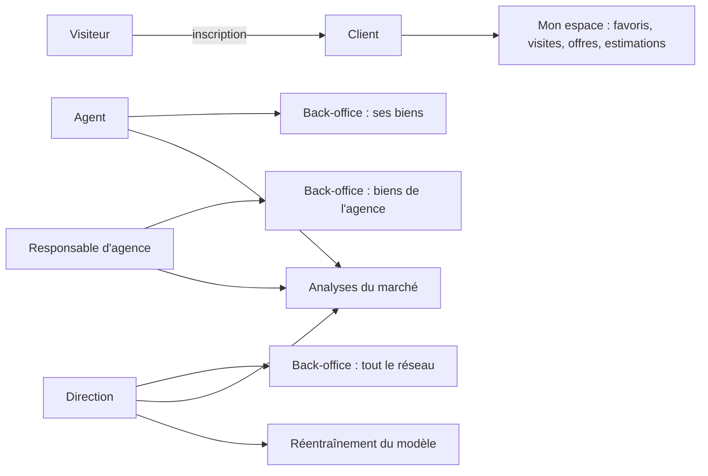
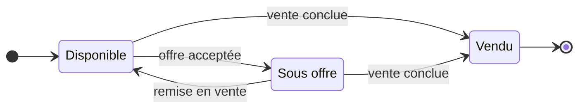
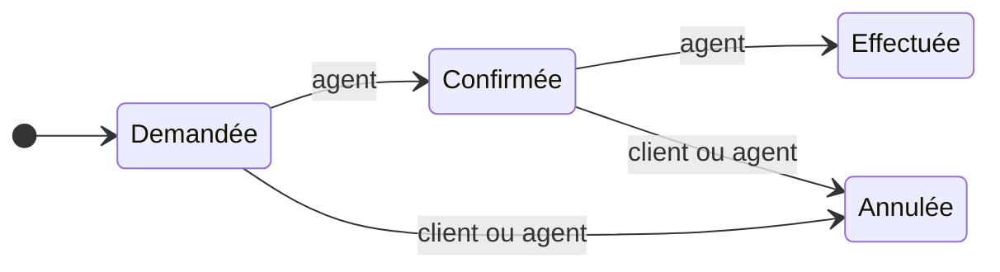
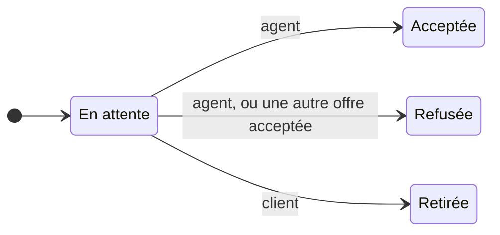
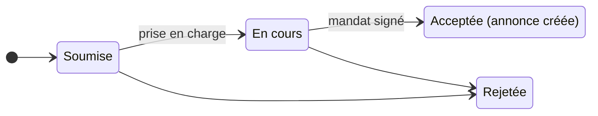
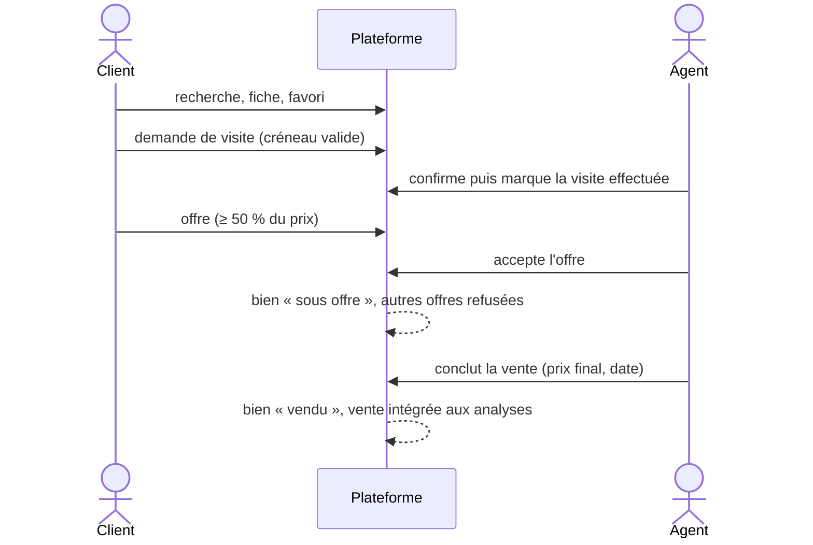

# Spécifications fonctionnelles — Plateforme Ymmo

Livrable DEV · Documentation fonctionnelle. Ce document décrit **ce que fait** la
plateforme : pour qui, avec quelles règles. La manière de le faire est expliquée dans la
[documentation technique](documentation-technique.md).

## 1. Contexte et besoins

Ymmo est un réseau d'agences immobilières : un siège à Aix-en-Provence et 12 agences en
France. Chaque agence gérait ses annonces et ses clients de son côté. Le brief demande :

| Besoin du client | Réponse de la plateforme |
|---|---|
| Une plateforme web **centralisée** pour l'achat et la vente | Un seul catalogue de biens pour les 13 sites, une seule base de clients |
| L'accès des **clients** et des **agents** | Un espace public, un espace client et un back-office des collaborateurs, avec des droits selon le rôle |
| Des **analyses de données** et des **prévisions IA** | Un tableau de bord du marché, l'estimation de prix par apprentissage automatique, la prévision des ventes et un score des zones où investir |
| Le traitement des **biens résidentiels et professionnels** | Deux types de biens et six catégories (appartement, maison, terrain, bureau, commerce, entrepôt) |

## 2. Acteurs et rôles

| Acteur | Rôle dans l'application | Ce qu'il peut faire |
|---|---|---|
| **Visiteur** | Non connecté | Consulter et rechercher les biens, voir une fiche, découvrir les agences, créer un compte |
| **Client** | `client` | En plus : favoris, demandes de visite, offres d'achat, demandes d'estimation pour vendre son bien, suivi de tout cela dans « Mon espace » |
| **Agent immobilier** | `agent` (rattaché à une agence) | Gérer **ses** biens (création, modification, photos, statut), traiter les visites et les offres sur ses biens, conclure les ventes, traiter les demandes d'estimation de son agence, consulter les analyses |
| **Responsable d'agence** | `manager` | Comme l'agent, mais sur **tous les biens de son agence**, et attribution des biens aux agents de l'agence |
| **Direction (siège)** | `admin` | Tout le réseau : tous les biens et toutes les agences, réentraînement du modèle de prix |

Un collaborateur appartient toujours à une agence ; un client ou la Direction n'en ont pas.
La base de données garantit cette règle (contrainte `agency_only_for_staff`).

## 3. Fonctionnalités

### 3.1 Espace public

| # | Fonctionnalité | Description | Règles |
|---|---|---|---|
| F1 | Accueil | Sélection de 6 biens disponibles, nombre de biens en vente, carte des 13 agences, accès à la recherche et à l'estimation | — |
| F2 | Recherche de biens | Liste paginée (12 par page), avec des filtres : ville ou code postal, type, catégorie, prix min/max, surface min/max, nombre de pièces. Tris : plus récents, prix croissant/décroissant, plus grande surface, prix au m² | Par défaut, seuls les biens **disponibles** sont listés. Un minimum supérieur au maximum est refusé |
| F3 | Fiche d'un bien | Photos (avec texte alternatif), caractéristiques, prix et prix au m², agence et agent, actions client | Chaque consultation est comptée : elle alimente la popularité et le score de demande des zones |
| F4 | Inscription / connexion | Création d'un compte client, connexion, déconnexion | Adresse e-mail unique ; mot de passe d'au moins 10 caractères avec une minuscule, une majuscule et un chiffre ; blocage après 5 échecs en 15 minutes |

### 3.2 Espace client (« Mon espace »)

| # | Fonctionnalité | Description | Règles |
|---|---|---|---|
| F5 | Favoris | Ajouter ou retirer un bien de ses favoris, les retrouver dans son espace | — |
| F6 | Demande de visite | Choisir une date et une heure, et laisser un message à l'agent | Au moins 2 h à l'avance, au plus 90 jours ; pas le dimanche ; entre 9 h et 19 h (heure de Paris) ; une seule visite en cours par bien et par client ; impossible sur un bien vendu |
| F7 | Annulation de visite | Le client annule sa propre demande | Seulement ses visites, et seulement si elles ne sont pas déjà faites ou annulées |
| F8 | Offre d'achat | Proposer un montant, avec un message | Pas sur son propre bien ; pas en dessous de 50 % du prix demandé ; une seule offre en attente par bien et par client ; impossible sur un bien vendu |
| F9 | Retrait d'offre | Le client retire une offre en attente | Seulement ses offres |
| F10 | Estimation de son bien | Le client décrit son bien (type, catégorie, surface, pièces, adresse, ville, prix souhaité). La plateforme affiche **immédiatement** une estimation de prix, puis transmet la demande à **l'agence la plus proche** | L'estimation vient du modèle d'apprentissage automatique ; à défaut, de la moyenne du marché local |
| F11 | Tableau de bord client | Ses favoris, visites, offres et estimations, avec leur statut | — |

### 3.3 Back-office des collaborateurs

| # | Fonctionnalité | Description | Règles |
|---|---|---|---|
| F12 | Tableau de bord | Indicateurs dans son périmètre : biens en vente, visites à venir, offres en attente, ventes et chiffre d'affaires | Agent : ses biens · responsable : son agence · Direction : le réseau |
| F13 | Publier un bien | Formulaire complet ; référence générée automatiquement | Un agent publie dans son agence et à son nom. Un responsable peut attribuer le bien à un agent de son agence. La Direction choisit l'agence. Prix et surface strictement positifs ; catégorie cohérente avec le type ; pas plus de chambres que de pièces |
| F14 | Modifier / supprimer un bien | — | Seulement les biens que l'on gère (règle F12). Un bien vendu ne peut plus être modifié ni supprimé : il est conservé pour l'historique des ventes |
| F15 | Photos | Ajout et suppression de photos | JPEG, PNG ou WebP, 8 Mo au maximum ; un **texte alternatif est obligatoire** (accessibilité) |
| F16 | Visites | Confirmer, marquer comme effectuée, annuler | Seulement les visites sur ses biens, en respectant les transitions du § 4 |
| F17 | Offres | Accepter ou refuser | Accepter une offre **passe le bien « sous offre »** et refuse automatiquement les autres offres en attente. Une seule offre acceptée par bien (garanti par la base) |
| F18 | Conclure la vente | Enregistrer la vente : prix final et date de signature | Il faut une offre acceptée ; une seule vente par bien ; le bien passe « vendu » |
| F19 | Demandes d'estimation | Prendre en charge, refuser, ou **convertir en annonce** quand le vendeur signe un mandat | Traitées par l'agence à laquelle elles sont rattachées. La conversion crée le bien, avec le client comme vendeur |

### 3.4 Analyses et intelligence artificielle (collaborateurs)

| # | Fonctionnalité | Description |
|---|---|---|
| F20 | Vue d'ensemble du marché | Nombre de ventes, prix moyen et médian au m², durée moyenne de vente, avec un rapport de nettoyage des données (lignes écartées et pourquoi) |
| F21 | Prix par ville | Prix au m² par ville et par catégorie |
| F22 | Biens populaires | Biens les plus consultés et les plus mis en favoris |
| F23 | Durées de vente | Délai entre publication et vente, par ville et par type |
| F24 | Performance des agences | Ventes, chiffre d'affaires et délai moyen par agence |
| F25 | Prévision des ventes | Projection sur 12 mois du nombre de ventes (avec un intervalle de confiance) et du prix au m², avec la tendance annuelle |
| F26 | Zones où investir | Score de 0 à 100 par ville. Il combine la croissance du prix à qualité égale (45 %), la rapidité de vente (25 %), la demande en ligne (15 %) et le prix relatif au département (15 %) |
| F27 | Graphiques | Graphiques générés côté serveur, chacun accompagné d'un tableau de données (accessibilité) |
| F28 | Exports | Ventes au format CSV (filtrables par agence et par année), rapport PDF complet |
| F29 | Modèle de prix | La Direction peut réentraîner le modèle sur les dernières ventes ; ses indicateurs de qualité sont affichés (erreur moyenne en euros, R²) |

## 4. Cycles de vie

Chaque objet métier suit un automate : une transition non prévue est refusée par
l'application, avec un message clair.

**Bien**

**Visite**

**Offre**

**Demande d'estimation**

## 5. Parcours principaux

### 5.1 Achat

### 5.2 Vente (estimation → mandat → annonce)

1. Le client remplit le formulaire « Estimer mon bien » et voit immédiatement le prix estimé.
2. La demande arrive dans le back-office de l'agence la plus proche, calculée par la distance réelle entre la ville du bien et chaque agence.
3. Un agent la prend en charge et contacte le client.
4. Mandat signé : l'agent convertit la demande en annonce, avec titre, description et prix. Le client devient le vendeur du bien, et ne peut donc pas faire d'offre dessus.

## 6. Exigences non fonctionnelles

| Domaine | Exigence | Mise en œuvre |
|---|---|---|
| **Sécurité** | Mots de passe protégés, sessions sûres, droits vérifiés côté serveur | Hachage Argon2id ; jeton JWT dans un cookie `HttpOnly` `SameSite=Lax` ; contrôle d'origine des requêtes (CSRF) ; en-têtes CSP, `X-Frame-Options` ; limitation des tentatives de connexion ; chaque action vérifie le rôle **et** le périmètre (§ 2) |
| **Accessibilité** | Utilisable au clavier et avec un lecteur d'écran (RGAA / WCAG 2.1 AA) | HTML sémantique, contrastes vérifiés, texte alternatif obligatoire sur les photos, tableaux de données sous les graphiques, animations désactivées si l'utilisateur le demande (`prefers-reduced-motion`) |
| **Responsive** | Du téléphone à l'écran large | Mise en page fluide, images servies en plusieurs tailles selon l'écran |
| **Performance** | Pages rapides, même en agence derrière le VPN | Pages rendues côté serveur, graphiques en SVG sans bibliothèque JavaScript, images optimisées, index sur les recherches fréquentes, analyses mises en cache |
| **Fiabilité** | Pas d'état incohérent | Automates de statut (§ 4), contraintes en base (prix positifs, une seule offre acceptée par bien), transactions |
| **RGPD** | Données personnelles minimales et protégées | Seules les données utiles au service sont collectées ; la base n'est pas exposée sur le réseau ; données hébergées en France (cf. solution cloud) |
| **Disponibilité** | Supervision possible | Points de contrôle `/api/health` et `/api/health/db` |
| **Interopérabilité** | Autres outils ou application mobile future | API REST documentée automatiquement (OpenAPI, `/docs`) |

## 7. Hors périmètre (évolutions possibles)

- Paiement en ligne et signature électronique des actes : ils restent chez le notaire.
- Messagerie en temps réel entre client et agent ; notifications par e-mail ou SMS.
- Application mobile native : l'API REST la permet déjà.
- Import automatique des données publiques DVF : le nettoyage les prend en charge (`clean_dvf`), mais aucun import planifié n'est en place.
